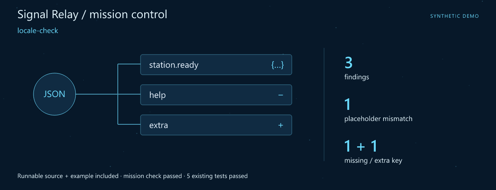
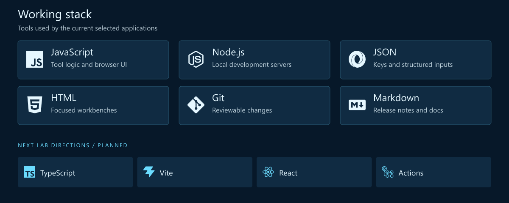
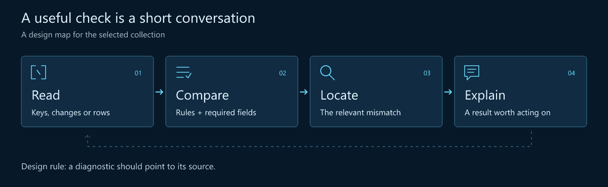
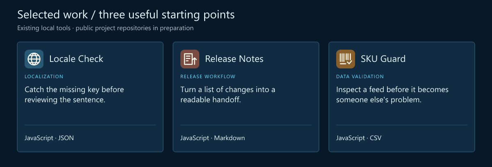

# Nori · JavaScript Developer · Developer Experience

> **Signal Relay** · Turn scattered signals into a clear handoff.

**Make the small checks feel like part of the workflow.**

[Download the runnable mission](src/assets/launch.zip) · [Launch guide](src/LAUNCH.md) · [Working stack](#working-stack) · [Selected work](#selected-work)

## Mission control



**First launch: locale-check.** A complete source snapshot, synthetic example and assertion script are included. The mission check and **5 existing tests** passed. [Try the mission](src/LAUNCH.md) · [Snapshot and checked result](src/assets/launch.json).

I'm Nori. I like the details that decide whether a handoff feels smooth: translation keys that agree, a changelog someone can follow, a product feed that has been checked before it moves on.

The goal is a shorter path from “something looks wrong” to an actionable explanation. Small developer tools are a good place to make that path visible.

## What I focus on

- **Developer experience.** Checks should fit the task, explain their result and point to the next action.
- **Localization workflows.** Key parity and placeholder consistency before the wording review.
- **Release readiness.** Readable notes and structured inputs make a handoff easier to review.

## Working stack



The upper panel shows technologies used by the selected tools. The lower row is the next lab track.

## How I think about the work



## Selected work

Three existing local tools form this curated collection. Their public project repositories are being prepared.



| Project / stack | Why it belongs here | Input → output |
| --- | --- | --- |
| **Locale Check**<br>JavaScript · JSON | Catch the missing key before reviewing the sentence. Compare JSON keys and translation placeholders across source and translated files. | **In:** Two translation JSON inputs<br>**Out:** Key and placeholder findings |
| **Release Notes**<br>JavaScript · Markdown | Turn a list of changes into a readable handoff. Prepare a changelog from selected local change entries, then edit the text for a reader. | **In:** Version, date + change entries<br>**Out:** An editable changelog |
| **SKU Guard**<br>JavaScript · CSV | Inspect a feed before it becomes someone else's problem. Check required fields and duplicate SKU values in a product CSV feed. | **In:** CSV + field requirements<br>**Out:** A feed validation result |

### One placeholder worth keeping consistent

```json
{
  "source": { "cart.total": "Total: {amount}" },
  "translation": { "cart.total": "Итого: {amount}" }
}
```

A synthetic comparison example: the wording changes while the key and placeholder stay aligned.

## Code and activity


These charts refresh from real GitHub observations on every successful workflow run, scheduled every six hours. At most one daily snapshot is committed; later runs still rebuild and publish the charts. Snapshot commits are labelled automated and authored by the profile owner using a verified GitHub noreply identity, with github-actions[bot] as committer. Owner contribution attribution follows GitHub rules; repository charts still include all authors. The observation time is printed on every chart. Commits are unique default-branch SHAs across all authors and owned public repositories, including forks. Language bytes describe repositories, not personal skill. Public interactions are a limited event feed (up to 300 events / 30 days), not visitor analytics. API and image caches may delay updates.

[Live data and scope](https://n9911.github.io/n9911/src/assets/live/metrics.json) · [Portfolio website](https://n9911.github.io/n9911/) · [Refresh setup](src/SETUP.md)

## Next lab

1. **Type the boundary.** Explore TypeScript contracts for inputs and diagnostics.
2. **Make findings easier to follow.** Add clearer paths from a result to its key, field or row.
3. **Keep examples close.** Create small fixtures that show an expected result beside its input.

## Start a conversation

A missing translation key, a confusing diagnostic or a changelog that needs a better shape is a useful starting point for a repository issue.

[Open the profile repository's issues](https://github.com/n9911/n9911/issues) · [Browse the repositories](https://github.com/n9911?tab=repositories)

> 🧩 Making the small tools fit together.

---

<sub>Fictional developer persona · AI-illustrated avatar. Curated tools retain original authors, licenses and commit history. Technology icons: Simple Icons.</sub>

[Artwork and data notes](src/assets/NOTICE.md)
